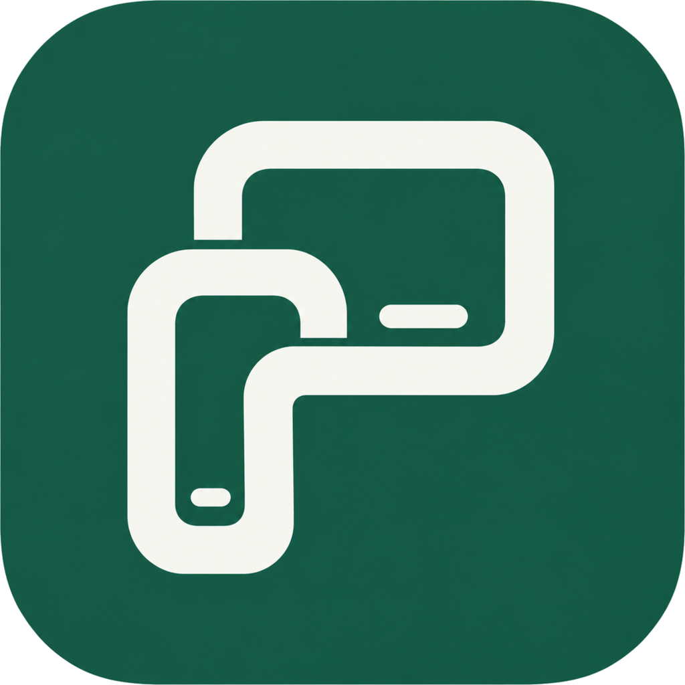
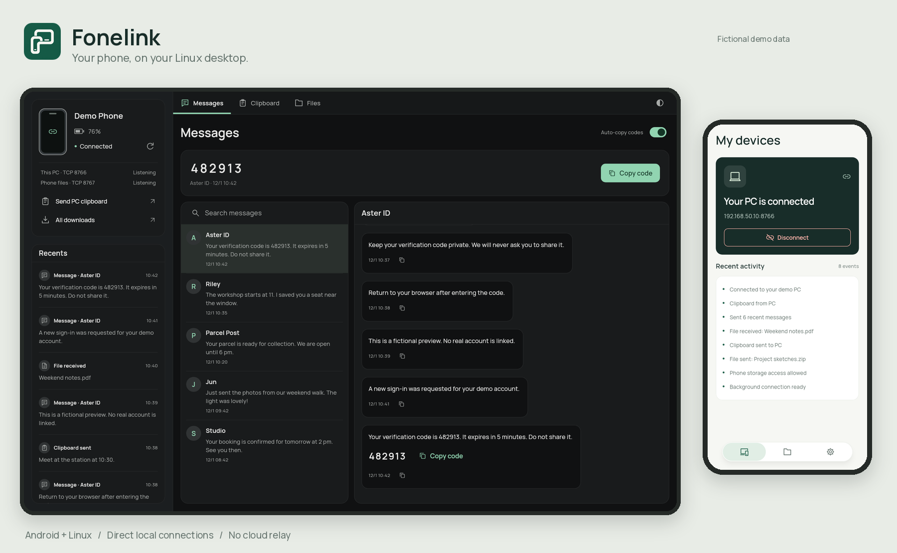
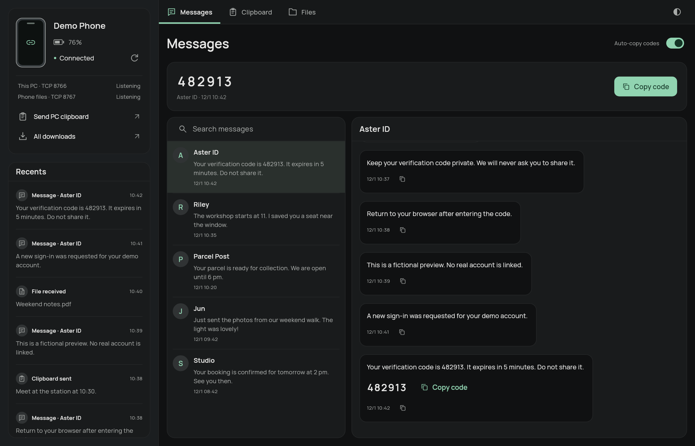
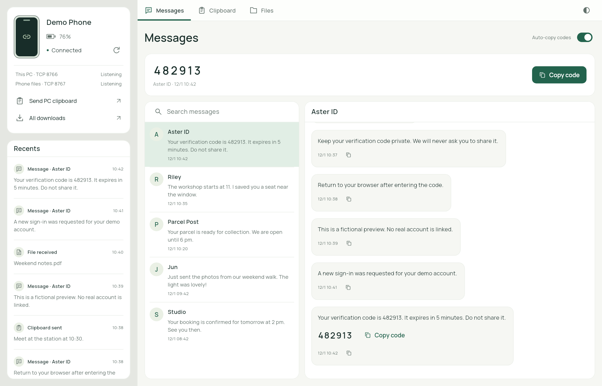
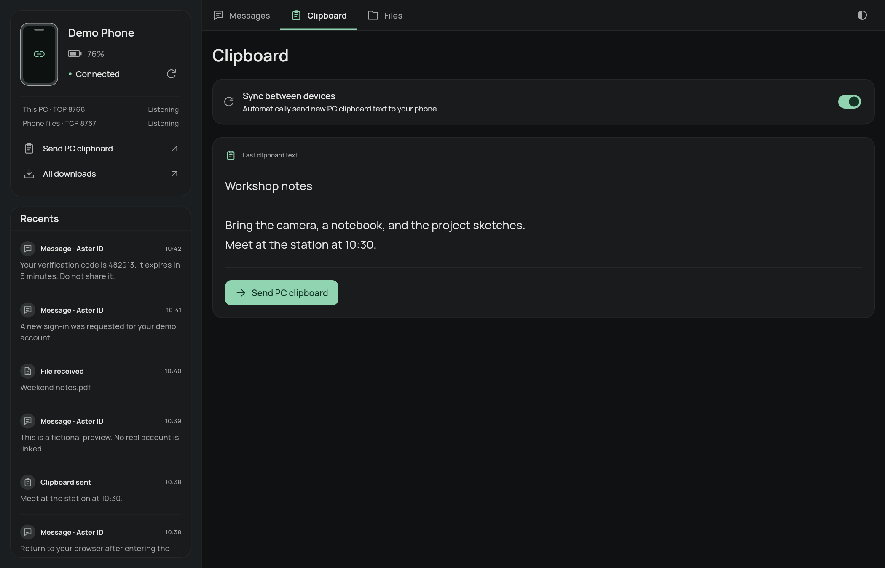
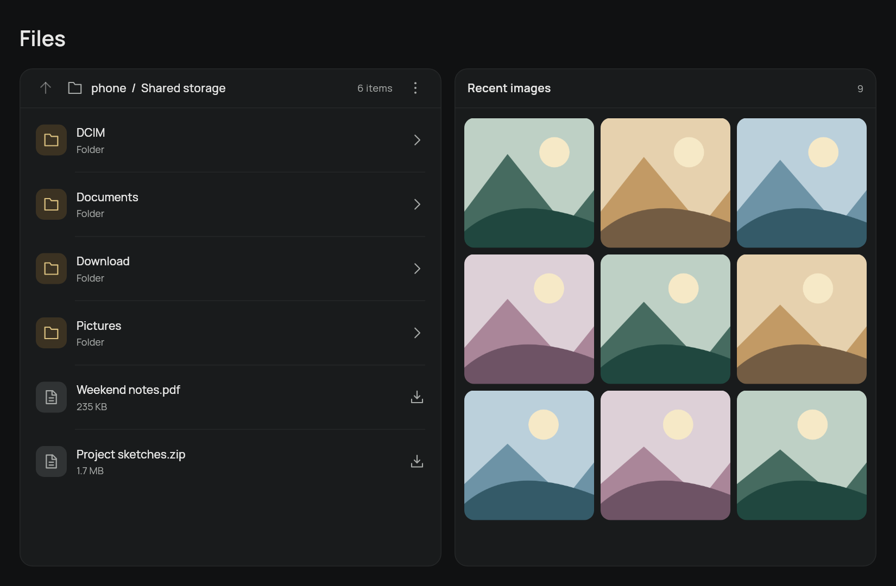
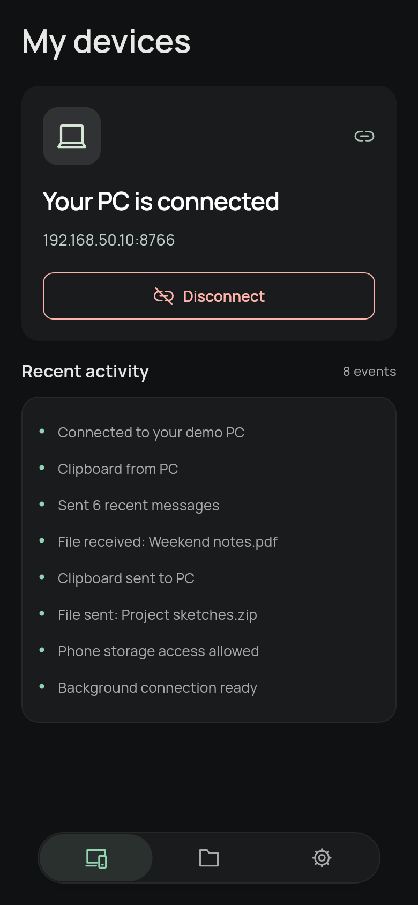
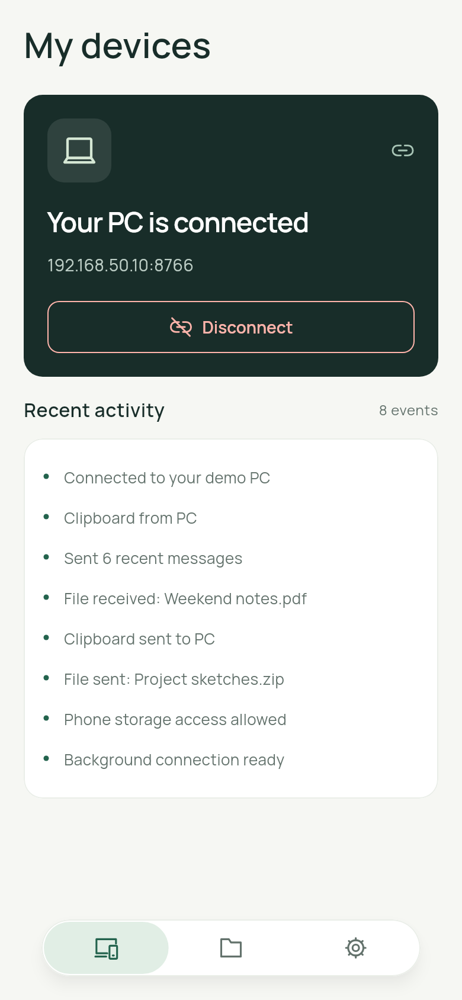
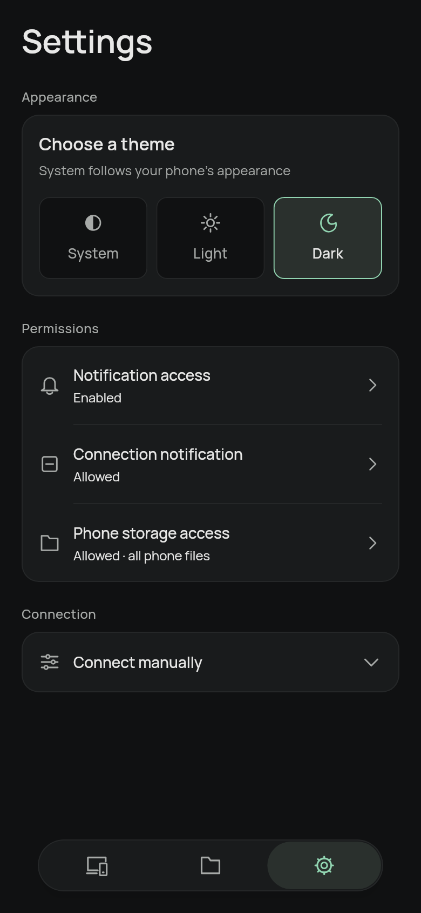
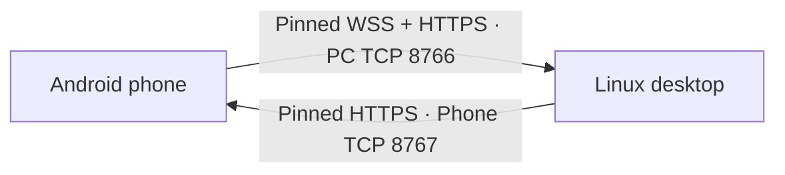

<p align="center">
  
</p>

<h1 align="center">Fonelink</h1>
<p align="center">Messages, clipboard and files between your Android phone and Linux desktop.</p>
<p align="center">Direct local connections · Pinned TLS · No account or cloud relay</p>



Fonelink is a Flutter companion app for **Android and Linux**. Read recent SMS messages on your PC, copy verification codes, move text between devices, browse shared folders and download recent phone pictures. Pair once using a QR code and keep both devices on the same reachable local network.

This is an independent project, not Microsoft Phone Link. Windows, macOS and iOS are not supported targets of this repository.

The display name is **Fonelink**. Existing `phonelink` package IDs, installation/configuration paths and `PhoneLink` download folders are retained for compatibility with installed copies and saved pairings.

> **Sharing boundary:** the desktop currently shares your **whole home folder**, including ordinary hidden files, with a paired phone. The phone can read and overwrite shared files. Fonelink’s own desktop credential directory is excluded. Pair only devices you trust and keep the pairing QR/token private. See [Security](#security-and-privacy).

## What it does

| Area | Behavior |
| --- | --- |
| Messages | Recent SMS inbox sync, live incoming messages, sender conversations and search. |
| Verification codes | A latest-code banner, copy buttons and optional auto-copy. Detection requires OTP/verification context instead of accepting every number. |
| PC → phone clipboard | Copies text automatically while connected, including when the PC window is in the tray. Phone updates are dropped while the phone is locked or its screen is off. |
| Phone → PC clipboard | Copy text, then tap **Send clipboard to PC** in the Android notification shade. No continuous background reading of the phone clipboard. |
| Files | Browse phone storage from Linux and your shared PC home folder from Android; upload and download files. Hidden dotfiles are hidden by default with a menu option to show them. |
| Recent pictures | Browse a paginated grid from the phone’s supported photo folders, preview images and save them to the PC. |
| Recents | A session activity list combining SMS, clipboard events and completed file transfers. |
| Linux tray | Closing the window hides it to the tray. **Open Fonelink** restores it; **Quit Fonelink** exits. |
| Login startup | The Linux installer enables quiet desktop-login autostart, with the app hidden in the tray. |
| Android background service | Keeps the shared runtime and connection running without the app screen; restores an enabled saved pairing after reboot/update where Android permits it. |
| Appearance | Light/dark desktop themes; Android follows the system by default with System, Light and Dark choices. |

SMS is **read-only**: composing replies, making calls and launching phone apps are not implemented. OTP detection is a conservative local heuristic, not a guarantee that every code will be recognized. There is no cloud AI processing.

## Screenshots

All previews below are rendered from Flutter using **fictional fixture data**. No real messages, contact details, clipboard contents, storage listings, pairing credentials or QR codes are used. Android system status/navigation chrome is omitted. The gallery preview uses the actual file-browser/gallery components with generated placeholder illustrations.

### Desktop

| Dark messages | Light messages |
| --- | --- |
|  |  |

| Clipboard | File-browser and gallery preview |
| --- | --- |
|  |  |

### Android

<p align="center">
  
  
  
</p>

## Requirements

- **Android 7.0 / API 24 or newer**, based on the currently built APK. Vendor background restrictions can affect reliability.
- A **Linux desktop** with GTK 3 and a compatible graphics stack. The provided build workflow targets x64; a bundle built on one distribution is not guaranteed to run on older distributions.
- Both devices on a reachable **local IPv4 network**. Literal private/link-local/loopback addresses are accepted; public addresses and DNS hostnames are rejected by the application transport.
- **OpenSSL on the PC**, used locally to generate certificate identities.
- A StatusNotifier/AppIndicator-capable panel and `libayatana-appindicator3.so.1` or `libappindicator3.so.1` for the Linux tray. Without a connected tray host, closing the window exits normally.
- On Wayland, **XWayland / `DISPLAY`** is needed for the current background clipboard bridge. The window itself stays native Wayland. Without that bridge, normal foreground clipboard behavior remains available.

An internet connection may be needed to obtain Flutter, Android SDK components and build dependencies. **The app’s own runtime protocol does not need an internet service or cloud account.** USB debugging is a developer installation/testing tool, not a runtime requirement.

## Build and install

This repository contains two Flutter applications. Generated APKs and Linux bundles are intentionally excluded from Git; maintainers can attach them to **GitHub Releases**. A source checkout does not include `dist/`.

### Development tools

The current project was built with **Flutter 3.41.0 / Dart 3.11**. Both `pubspec.yaml` files require Dart `^3.11.0`. Keep both application lockfiles in source control.

Install the [Flutter SDK and Linux desktop toolchain](https://docs.flutter.dev/platform-integration/linux/setup), plus Android SDK/JDK support for Android builds. The Android project compiles Java/Kotlin against Java 17 and uses Android SDK 36 with the tested Flutter version. `file_picker` has a project-local compile-SDK 36 override; no changes to the global pub cache are required.

On Debian/Ubuntu-style systems, the native build dependencies commonly include:

```bash
sudo apt install clang cmake ninja-build pkg-config libgtk-3-dev g++ openssl
```

Install your distribution’s AppIndicator runtime package for tray support (for example, `libayatana-appindicator3-1`). Use the corresponding packages on other distributions.

### Linux

From the repository root:

```bash
cd phonelink_desktop
flutter pub get
flutter build linux --release
cd ..
./scripts/install-desktop.sh
```

The installer requires no administrator privileges. It installs the complete bundle, icon and application-menu launcher, and enables desktop-login autostart with `--start-in-tray`. Open **Fonelink** from your application menu for the initial pairing.

Default installed locations:

| Item | Default path |
| --- | --- |
| Application bundle | `~/.local/share/phonelink/` |
| Menu launcher | `~/.local/share/applications/dev.phonelink.PhoneLink.desktop` |
| Login autostart | `~/.config/autostart/dev.phonelink.PhoneLink.desktop` |
| Icon | `~/.local/share/icons/hicolor/512x512/apps/dev.phonelink.PhoneLink.png` |
| Runtime configuration and certificates | `~/.config/phonelink/` |

The installer honors `XDG_DATA_HOME` and `XDG_CONFIG_HOME` for desktop integration. The application’s credential directory currently uses the home-folder path shown above. Remove the autostart entry to disable login startup. Autostart occurs **after desktop login**, not as a headless service before login.

### Android

```bash
cd phonelink_android
flutter pub get
flutter build apk --release
```

The APK is produced at:

```text
phonelink_android/build/app/outputs/flutter-apk/app-release.apk
```

For a developer install, connect and authorize your phone through ADB, then run from the repository root:

```bash
adb install -r phonelink_android/build/app/outputs/flutter-apk/app-release.apk
```

Open the phone app once to grant the permissions you need. Normal use does not require ADB, a cable or USB debugging.

**Signing:** the current Android release build configuration uses the developer’s debug signing key. It is suitable for personal development installs, not a finished public signing setup. Configure a private release keystore before publishing production APKs, and keep that key outside Git. Updating an existing installation requires the same signing key. See [Release preparation](docs/RELEASING.md).

Google Play Protect can block sideloaded applications requesting SMS or notification-listener access. This is a distribution/permission issue that the app cannot guarantee to avoid; review [Google’s developer guidance](https://developers.google.com/android/play-protect/warning-dev-guidance). Changing the icon or signing key alone does not guarantee the block disappears. Keep Play Protect enabled.

## Pair your devices

1. Start the Linux app and choose **Pair phone** in the device card.
2. On Android, choose **Scan PC code** and grant camera access.
3. Scan the QR displayed by **your own PC**. It contains local addresses, a pairing secret and the PC certificate fingerprint.
4. Grant SMS/storage/notification permissions for the features you want, then leave the apps connected.

Manual pairing is available in phone **Settings → Connect manually**. Copy the PC address, pairing token and certificate fingerprint from the desktop pairing dialog. A hostname such as `my-pc.local` is not accepted; use the local IPv4 address and port.

Pairing material is sensitive. Do not put a real pairing QR, token, runtime configuration or private certificate key in screenshots, issues or source control. To revoke a paired device, use desktop **Pair phone → Manual connection → Reset pairing** and pair again. On a phone you are retiring, also use **Forget this PC**.

## Daily use

### Messages and codes

Messages arrive over the persistent encrypted connection. The **latest recognized OTP** appears above the conversation list. Turn off **Auto-copy codes** if you prefer manual copying. Amounts, phone numbers and labelled reference IDs are rejected by the OTP detector, and ambiguous messages may produce no code. A banking transaction amount is not treated as an OTP just because it has six digits.

The desktop refresh icon in the device card requests fresh status/messages and refreshes the file views. There is no separate Messages/gallery refresh button.

### Clipboard

- **PC → phone:** copy text normally on the PC. The desktop can stay in the tray. Explicit app copy buttons use the same synchronization path.
- **Phone → PC:** copy text in another phone app, open the notification shade and tap **Send clipboard to PC**. A small native activity briefly acquires focus to read the clipboard, then returns to the previous app; the main Flutter screen is not opened.
- **Locked/off-screen phone:** incoming clipboard writes are discarded, not queued for a later unlock. Copy again after unlocking if needed.
- Echo guards stop an item sent from the phone from immediately being sent back as a new PC copy.

Android may show its own clipboard privacy indicators. Fonelink does not continuously monitor the phone clipboard in the background, and a foreground service does not grant unrestricted background clipboard reads.

### Files and pictures

The desktop **Files** page contains the phone browser and recent-picture grid. Its three-dot menu contains **Send files**, **Refresh**, and **Show/Hide hidden files**. The Android **PC files** page uses the same general menu pattern.

**All downloads** opens the dedicated PC folder `~/Downloads/PhoneLink`. Phone downloads go to `/storage/emulated/0/Download/PhoneLink`.

The gallery scans supported phone photo/download folders, loads pages as requested and caches thumbnails in memory. It is not a cloud photo library or a complete Android media-management service.

### Background operation and shade controls

The Android foreground service keeps the shared Flutter runtime alive when the activity is removed from Recents. It reconnects to saved PC addresses while the connection is enabled. The ongoing notification shows **PC connected**, **Waiting for PC**, or **Disconnected**, with the clipboard-send action.

If Android removes the notification while the service remains alive, the service checks for missing controls **every five seconds** and on screen-on/unlock, then silently restores them. Android scheduling can delay this. On Android 14+, the app cannot universally make the entry impossible to swipe away.

In phone **Settings → Connection notification**, verify that notifications are allowed. Also allow background battery usage where your phone vendor requires it. **Force stop**, Android’s foreground task-manager **Stop**, disabled channels and vendor process restrictions are respected. A force-stopped app must be opened again; turning on the PC cannot remotely wake it without a running phone component. No cloud push service is used.

## Connection and ports



| Listener | Where it runs | Purpose |
| --- | --- | --- |
| TCP **8766** | Linux PC | WebSocket events for SMS/clipboard/status and HTTPS access to the PC shared folder. |
| TCP **8767** | Android phone | HTTPS access to phone files, thumbnails and recent-image listings. |

The phone’s port 8767 does **not** reserve port 8767 on your PC. Outgoing connections also use temporary ports chosen by the OS. The device card shows the PC listener state and the phone-reported file-server availability.

Do not forward these ports from your router. Use a trusted LAN; guest-network isolation or host firewalls can prevent pairing. A development copy of the desktop app cannot bind TCP 8766 while the installed copy already owns it—quit the installed app from its tray before running `flutter run -d linux`. Other localhost dev servers on different ports can run normally.

## Security and privacy

- Files and event traffic use **HTTPS/WSS with pinned TLS certificates**. The phone checks the PC certificate fingerprint established during pairing.
- Pairing uses a random **256-bit secret**; requests authenticate before file operations or WebSocket upgrade. Browser origins and ambiguous credential headers are rejected.
- Only supported local IPv4 destinations are accepted. The transport does not use environment proxies, public-host fallback, cloud relay or redirect following.
- The authenticated PC provisions a separate certificate identity for the phone file server, which the PC pins. This is a paired-device trust model; the PC knows that provisioned identity’s key.
- Shared paths are canonicalized; traversal/symlink escapes and access to Fonelink’s own PC credential directory are blocked. Uploads are staged before replacing the destination.
- Desktop credentials use a private directory/file permission policy; Android pairing material stays in the app sandbox and is excluded from Android backups.

**Important limits:** encryption protects traffic between devices, not the original carrier SMS, an unlocked screen, clipboard previews or stored user files. There is no additional application-level ciphertext layer beyond TLS. A compromised paired device can access the intentionally shared home-folder contents, including other applications’ secrets and executable configuration. The app does not provide a kernel-enforced filesystem sandbox or comprehensive denial-of-service quotas. LAN peers can still reach the TLS listeners and attempt connections.

This is a personal project with local security checks, **not an independent penetration-test certification or a claim of zero risk**. The [security model](SECURITY.md) and [dated audit](SECURITY_AUDIT.md) document what was checked, the fixes made and remaining limits. The audit is a point-in-time record, not continuous certification of later changes.

### Android permissions

| Permission/access | Current use |
| --- | --- |
| Internet | Required by Android for TCP sockets, including local-only HTTPS/WSS. It does not itself imply a cloud connection. |
| Read/receive SMS | Recent inbox and incoming-message forwarding. |
| Camera | Local QR scanning for pairing. |
| Notifications | The connection/clipboard controls in the notification shade. |
| All-files access / legacy storage | Browse and transfer user-visible phone files. Android version/storage rules still apply. |
| Network/Wi-Fi state | Connection/device status. |
| Phone state | Currently requested during setup alongside SMS; no calling feature is implemented. |
| Foreground service / boot completed | Maintain the runtime and attempt restoration of an enabled saved pairing. |
| Notification-listener access | Optional notification-relay backend. The current sidebar displays **Recents**, not a general notification inbox. The clipboard-send notification action does not require listener access. |

## Project structure

```text
phonelink/
├── phonelink_desktop/       Flutter Linux UI, local hub and PC file API
│   ├── lib/                UI, pinned transport, clipboard bridge client, OTP detection
│   └── linux/runner/       GTK window/tray and background clipboard integration
├── phonelink_android/       Flutter Android UI and phone file API
│   ├── lib/                Pairing, event connection, file views and themes
│   └── android/app/src/    Foreground runtime, notification controls and native SMS/clipboard
├── assets/branding/        App icon source and master artwork
├── scripts/                Linux user installer
├── docs/images/            Public, dummy-data documentation renders
├── docs/RELEASING.md        Publishing/signing checklist
├── INSTALL.md              Detailed install/background behavior notes
├── SECURITY.md             Transport and sharing trust model
└── SECURITY_AUDIT.md        Point-in-time security review
```

## Development and checks

Run commands from the indicated app directory. Native Android changes require a rebuilt/reinstalled APK; hot restart cannot update Kotlin, manifests or launcher resources.

```bash
# Desktop, from phonelink_desktop/
flutter analyze
flutter test test/otp_test.dart test/desktop_clipboard_test.dart
flutter test
flutter run -d linux

# Phone, from phonelink_android/
flutter analyze
flutter test
flutter run

# Pure-Dart local security checks, from phonelink_android/
dart run tool/security_check.dart
```

The security check creates temporary loopback TLS servers/files; it does not launch either Flutter app. It checks authentication, pinning, redirect rejection, local-only destinations, shared-root protections and transfer behavior. It is not an external network penetration test.

Regenerate the public previews with the offline fixture renderers:

```bash
# From the repository root:
(cd phonelink_desktop && flutter test tool/readme_screenshots_test.dart)
(cd phonelink_android && flutter test tool/readme_screenshots_test.dart)
python3 scripts/compose-readme-preview.py
```

The composition script requires Pillow. See [image provenance and regeneration](docs/SCREENSHOTS.md). The renderers do not start app services, use a real pairing or access your actual device storage.

Project navigation uses Graphify. Keep generated project graphs local in `graphify-out/`; they are intentionally ignored by Git. Follow [AGENTS.md](AGENTS.md) when editing this repository.

## Troubleshooting

| Symptom | Check |
| --- | --- |
| No connection | Same reachable network, correct local IPv4 address, no guest isolation, correct permissions/firewall and both apps on protocol v2. |
| Port already in use | Quit the existing installed desktop instance from the tray before starting another copy on TCP 8766. |
| PC copies arrive only with its window focused | On Wayland, verify XWayland and `DISPLAY` are available so the background clipboard bridge can be used. |
| Phone copy does not reach PC | Use the shade action after copying, leave the connection enabled, and keep the PC reachable. Android may need brief focus to read the phone clipboard. |
| PC copy does not appear on phone | Unlock the phone and keep its screen on; locked-screen updates are intentionally dropped. |
| Shade controls disappear | Enable connection notifications/channel and background battery usage. The running service restores a missing entry on its next check/unlock; Force stop requires reopening the app. |
| Files show an access error | Grant phone all-files access and check normal OS permissions. Links outside the configured shared root are deliberately rejected. |
| Recent images look stale | Use **Refresh** in the file menu or the main device refresh; more images load through pagination. |
| Linux dock icon is old | Reopen using the installed application-menu entry; remove a stale pinned Flutter launcher and pin the current one. |
| Certificate or old-pairing failure | Update both apps and scan the new QR. Do not add an accept-any-certificate workaround. |
| APK update has a signature mismatch | Use the original signing key. A new key cannot silently update an existing installation. |
| Play Protect blocks installation | Follow Google’s developer/distribution guidance for sensitive permissions; do not assume a new icon or package signature fixes it. |

## Publishing and contributing

Read [docs/RELEASING.md](docs/RELEASING.md) before uploading a build. `.gitignore` excludes generated bundles, local SDK configuration, Graphify output and common signing/credential files. It does **not** remove anything already committed to Git history.

Use fictional examples in issues and screenshots. Do not attach OTPs, real SMS, clipboard contents, private files, pairing QRs/tokens or signing material. Prefer reproducible steps, OS/Android/Flutter versions and a redacted log describing the failure.

No project-wide software license has been selected in this repository. Add a `LICENSE` before granting reuse/distribution rights; do not assume an MIT license. Manrope’s existing OFL notices are included with the font assets. See [third-party notices](docs/THIRD_PARTY_NOTICES.md).
